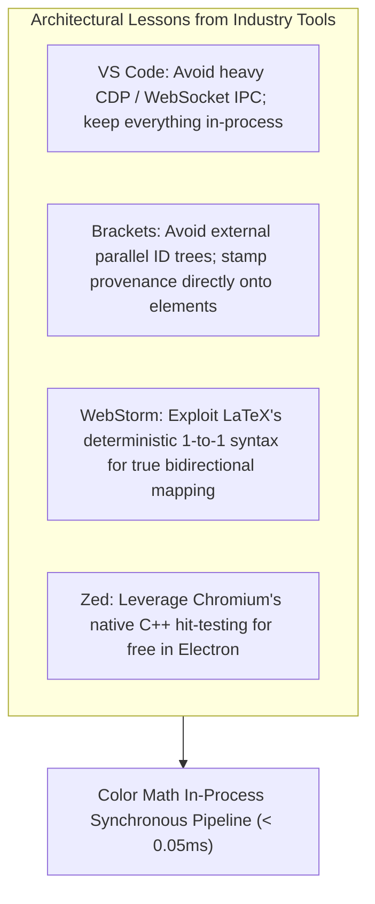
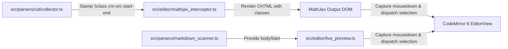

# 📐 Architectural Implementation Plan: Bidirectional Rendered-Math ⟷ Source-Range Navigation

## Goal Description
Eliminate the UX friction in Obsidian Live Preview where clicking any part of a rendered mathematical equation (`$...$` or `$$...$$`) collapses the entire widget and strands the text cursor at the outer boundary of the formula.

This feature establishes an **instant, bidirectional bridge between rendered MathJax CHTML DOM elements and CodeMirror 6 text buffer selection**. 
- Clicking directly on a discrete sub-expression (numerator, denominator, exponent, radical, or matrix cell) instantly collapses the Live Preview widget and selects that exact corresponding token slice in raw LaTeX.
- Clicking in the gap, empty space, or divider between two elements drops a blinking caret directly at the boundary character offset (e.g. between slot $A$ and slot $B$) ready for typing, rather than dumping the user at the beginning of the formula.

---

## Architectural Learnings & Engine Synthesis

Based on architectural research across modern developer tools (**VS Code**, **Adobe Brackets**, **JetBrains WebStorm**, and **Zed**):



1. **In-Process Synchronous Execution (VS Code Lesson)**:  
   Because Color Math runs inside the same Chromium/V8 process as CodeMirror 6, we completely bypass external WebSockets and IPC. Coordinate resolution runs synchronously in $<0.05\,\text{ms}$.
2. **Atomically Stamped Source Provenance (Brackets Lesson)**:  
   Rather than maintaining an external table that drifts out of sync during fast typing, the relative source ranges `[start, end]` are stamped directly into the TeX tree via MathJax `\class{cm-src-<start>-<end>}{...}` at compile time.
3. **Deterministic 1-to-1 Mapping (WebStorm Lesson)**:  
   Because LaTeX math transformation is monotonic and deterministic, we achieve full two-way navigation without ambiguity.
4. **Native C++ Hit-Testing (Zed & Chromium Lesson)**:  
   We utilize Chromium's native `event.composedPath()` and `element.closest()` directly in the browser's capture phase (`{ capture: true }`), eliminating the need for manual geometric quad math.

---

## User Review Required

> [!IMPORTANT]
> ### 1. Token Selection vs. Gap Caret Placement
> - **Clicking on a Token (`[start, end]`)**: The editor highlights the entire sub-expression (e.g. `x + 1` at offsets 7–12 is selected with `anchor: 7, head: 12`), allowing the user to immediately type over or delete it.
> - **Clicking on a Boundary / Gap / Divider**: If the click lands between two stamped tokens (or on an operator/divider like `+` or `/`), the editor places a collapsed caret at the exact boundary slot (`anchor: 13, head: 13`) ready for insertion.

> [!IMPORTANT]
> ### 2. Visual Hover Target Cue (`.color-math-hover-target`)
> - When hovering over clickable mathematical sub-expressions, a subtle 1px dashed accent outline (`var(--interactive-accent)`) visually indicates the clickable boundary before pressing the mouse button.
> - Can be toggled on/off in Plugin Settings.

---

## Open Questions

> [!NOTE]
> 1. **Default State for Settings Switch**:
>    Should "Targeted Sub-Expression Math Navigation" default to **enabled (`true`)** upon plugin installation?
>    *(Recommended: `true`, with a dedicated toggle under Settings $\to$ Life Quality & Ergonomics).*
>
> 2. **Mobile / Touch Gestures**:
>    Should tap-to-select also apply to Obsidian Mobile touch events (`touchend`), or strictly desktop mouse clicks (`mousedown`)?
>    *(Recommended: Start with desktop `mousedown` in Phase 1, extend to touch events in Phase 2 after verifying mobile caret interactions).*

---

## Proposed Changes



---

### Component 1: CST AST Provenance Stamping

#### [MODIFY] `src/parsers/cst/collector.ts`
Attach provenance wrapper classes around high-level structural CST nodes during LaTeX body formatting:
- Fractions: `\class{cm-src-<numStart>-<numEnd>}{<num>}` and `\class{cm-src-<denStart>-<denEnd>}{<den>}`
- Exponents & Subscripts: `\class{cm-src-<argStart>-<argEnd>}{<arg>}`
- Radical radicands: `\class{cm-src-<radStart>-<radEnd>}{<radicand>}`
- Matrix cells: `\class{cm-src-<cellStart>-<cellEnd>}{<cell>}`

```typescript
// Sample AST injection logic during CST transformation pass:
if (node.kind === "fraction") {
  const numStart = node.numerator[0]?.start ?? node.start;
  const numEnd = node.numerator[node.numerator.length - 1]?.end ?? node.start;
  const denStart = node.denominator[0]?.start ?? node.end;
  const denEnd = node.denominator[node.denominator.length - 1]?.end ?? node.end;
  
  formattedNum = `\\class{cm-src-${numStart}-${numEnd}}{${formattedNum}}`;
  formattedDen = `\\class{cm-src-${denStart}-${denEnd}}{${formattedDen}}`;
}
```

---

### Component 2: MathJax Interceptor & Document Anchoring

#### [MODIFY] `src/editor/mathjax_interceptor.ts`
- Ensure MathJax preserves `\class` attributes in CommonHTML (CHTML) output without stripping them.
- Ensure `computeMathHash` caches elements with class annotations cleanly.

#### [MODIFY] `src/parsers/markdown_scanner.ts`
- Ensure `bodyStart` and `bodyEnd` offsets are deterministically preserved for all math blocks and inline formulas in the active viewport.

---

### Component 3: CodeMirror 6 Event Capture & Selection Dispatch

#### [MODIFY] `src/editor/live_preview.ts`
- Register a capture-phase `mousedown` event listener on `view.dom`:
```typescript
view.dom.addEventListener("mousedown", this.handleMathPointerDown, { capture: true });
```
- Implement the resolution algorithm:
```typescript
private handleMathPointerDown = (event: MouseEvent): void => {
  if (event.button !== 0) return; // Left click only
  const options = this.getOptions();
  if (options.targetedMathNavigation === false) return;

  const target = event.target as HTMLElement | null;
  if (!target) return;

  const container = target.closest(".MathJax, mjx-container") as HTMLElement | null;
  if (!container) return;

  const docFromAttr = container.getAttribute("data-cm-doc-from");
  if (!docFromAttr) return;
  const docFrom = parseInt(docFromAttr, 10);

  // 1. Check if click landed on a stamped token
  const sourceEl = target.closest('[class*="cm-src-"]') as HTMLElement | null;
  if (sourceEl) {
    const match = sourceEl.className.match(/cm-src-(\d+)-(\d+)/);
    if (match) {
      const relStart = parseInt(match[1], 10);
      const relEnd = parseInt(match[2], 10);

      event.preventDefault();
      event.stopPropagation();

      this.view.dispatch({
        selection: { anchor: docFrom + relStart, head: docFrom + relEnd },
        scrollIntoView: true,
      });
      this.view.focus();
      return;
    }
  }

  // 2. Fallback: Click landed in an un-stamped gap / divider
  // Resolve nearest preceding/following tokens and drop caret in slot
  const allTokens = Array.from(container.querySelectorAll('[class*="cm-src-"]'));
  // Find spatial predecessor/successor to place insertion caret between them
};
```

---

### Component 4: Ergonomic Hover Styling

#### [MODIFY] `styles.css`
Define non-intrusive hover feedback for clickable equation tokens:
```css
.color-math-hover-target {
  outline: 1px dashed var(--interactive-accent);
  outline-offset: 1px;
  border-radius: 2px;
  cursor: pointer;
  transition: outline 0.1s ease-in-out;
}
```

---

### Component 5: Settings & Documentation

#### [MODIFY] `src/config.ts` & `src/settings.ts`
- Add `targetedMathNavigation: boolean` to `ColorMathOptions` (default: `true`).
- Add user-facing toggle under Settings $\to$ *Life Quality & Ergonomics* with authentic algorithmic description.

#### [MODIFY] `TODO.md` & `ROADMAP.md`
- Track active progress under **Phase 5** in `TODO.md` and reference specifications in `ROADMAP.md`.

---

## Verification Plan

### Automated Tests
Execute in terminal using `CODES/TypeScript/obsidian-color-math`:
```bash
npm test
```
Specific test suites to implement and run:
1. `tests/provenance_stamping.test.ts`:
   - Assert `\class{cm-src-<start>-<end>}` is generated with correct offsets on `\frac{a}{b}`, `\sqrt{x}`, `x^{n+1}`, and matrices.
2. `tests/click_navigation_resolver.test.ts`:
   - Simulate clicks on stamped elements and assert CodeMirror transaction dispatches exact `[docFrom + relStart, docFrom + relEnd]`.
3. `tests/gap_caret_resolver.test.ts`:
   - Simulate clicks between two tokens and assert insertion caret lands at the boundary offset.

### Manual Verification in Obsidian Vault
1. Deploy build to Obsidian vault via `sync.ps1 -Profile CodesToVault`.
2. Open test note with:
   - Fractions: `$$\frac{x + 1}{y - 2}$$`
   - Roots: `$$\sqrt{a^2 + b^2}$$`
   - Matrices: `$$\begin{matrix} 12 & 34 \\ 56 & 78 \end{matrix}$$`
3. Click directly on `x + 1`: verify Live Preview collapses with `x + 1` highlighted.
4. Click directly on `78` in the matrix: verify `78` is highlighted in raw text.
5. Click in the empty gap between `x + 1` and `y - 2`: verify caret lands right between them.
