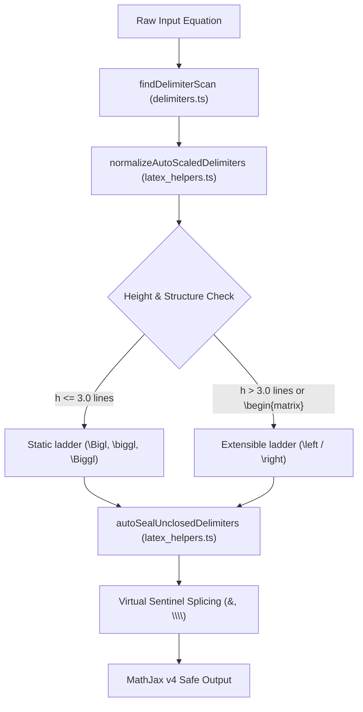

# 📐 Architecture Implementation Plan: Delimiter Auto-Scaling, MathJax v4 Alignment & Shift-Free Matrix Engine

## Goal Description
Resolve the core delimiter auto-scaling failures for determinants and multi-line matrices (e.g. `| \begin{matrix} ... \end{matrix} |` and `AB = [ \begin{matrix} \cfrac{a}{\cfrac{a}{b}} & b \\ c & d \end{matrix} ]`), align the engine with **MathJax v4** architectural improvements, and implement the dependency-ordered foundation for the Phase 2/3 Shift-Free Matrix and Grammar Normalization Pipeline.

---

## MathJax v4 Architecture & Impact Analysis

Recent updates in **MathJax 4.0** introduce significant structural enhancements and behavioral changes relevant to this implementation:

1. **Clip-Path Based Stretchy Delimiters (`\left` / `\right`)**:
   - In MathJax v3, CommonHTML (CHTML) stretchy delimiters relied on CSS transforms (`transform: scaleY(...)`), which frequently introduced subpixel alignment gaps, fuzzy rendering, and clipping boundary errors on extreme heights.
   - MathJax v4 completely overhauled stretchy delimiters using **repeated glyph extenders with SVG clip paths (`clip-path`)** and added vertical centering symmetry (`symmetric="true"`).
   - **Engine Impact**: Dynamic promotion from static `\Bigg` ($\approx 22\text{pt}$ / $3.0$ lines) to extensible `\left` / `\right` for tall matrices ($>3.0$ lines) is now visually crisp, gap-free, and officially recommended by MathJax v4 layout standards.

2. **Strict TeX Delimiter Scoping Across Alignment Cells**:
   - MathJax v4 preserves the invariant that raw `\left` / `\right` cannot span across alignment tab boundaries (`&`) or row breaks (`\\`) within an environment.
   - **Engine Impact**: Our existing `autoSealUnclosedDelimiters` virtual sentinel splicing (`\right. & \left.` and `\right. \\ \left.`) remains strictly mandatory and crash-proof.

3. **Array Preambles & Column Specifications**:
   - MathJax v4 broadens support for array preamble templates and custom column separators (e.g. `{cc|c}`).
   - **Engine Impact**: Validates our single-pass $\mathcal{O}(N)$ Augmented Matrix Partition Engine (`mat[1, 0 | 4; 0, 1 | 5]` $\to$ `\left[ \begin{array}{cc|c} ... \end{array} \right]`).

---

## User Review Required

> [!IMPORTANT]
> ### 1. Sizing Threshold Policy: Static `\Biggl` vs. Extensible `\left` / `\right`
> - **Height $\le 3.0$ lines**: Retains fixed sizing (`\Bigl` $\approx 1.8$, `\biggl` $\approx 2.5$, `\Biggl` $\approx 3.4$). This preserves Knuth's deliberate aesthetic choice to avoid excessive vertical delimiter growth around sub/superscripts or modest fractions.
> - **Height $> 3.0$ lines OR Matrix Environments**: Automatically promotes to dynamic `\left` / `\right` (with matching `\right` or virtual `\right.`), completely eliminating the visual truncation bug where tall matrices overflow static `\Biggl`.

> [!IMPORTANT]
> ### 2. Bare Pipe `|` Parity & Relation Reset Strategy
> - Bare pipes `|` are symmetric (both opening and closing look identical).
> - To prevent stray binary relation pipes (like `P(A|B)`) from inverting parity for the rest of an equation, stack resets are enforced upon encountering binary relation operators (`=`, `\le`, `\ge`, `\to`, `\implies`).
> - Evictions at commas `,`, semicolons `;`, and `=` are strictly depth-isolated (`braceDepth === stack[top].braceDepth && envDepth === stack[top].envDepth`) so indices ($a_{1,1}$, $A_{i,j}$) inside matrix cells never evict outer determinant bars.

---

## Open Questions

> [!NOTE]
> 1. **Default Sizing for Mid-Typing Unclosed Pipes**:
>    When typing `| \begin{matrix} a & b \\ c & d \end{matrix}` before the closing `|` is typed, should the opening bar scale as extensible `\left| ... \right.` or static `\Biggl|`?
>    *(Recommended: Extensible `\left|` with transient virtual `\right.` at equation end, matching completed equations).*
>
> 2. **Default Matrix Environment Setting Location**:
>    Should the bare `mat[...]` dropdown setting reside in **Settings $\to$ Life Quality** alongside delimiter scaling and matrix padding?
>    *(Recommended: Yes, grouped under the existing "Ergonomics & Life Quality" section).*

---

## Proposed Changes



---

### Component 1: Delimiter Sizing & Stack Engine (`src/utils/latex_helpers.ts`)

#### [MODIFY] `src/utils/latex_helpers.ts`

- **Dynamic Sizing Promotion**:
  Extend `getLevelFromHeight` or replace with an extensible resolution helper:
  ```typescript
  type DelimSizing = "Big" | "bigg" | "Bigg" | "left_right";

  function getSizing(height: number, hasMatrix: boolean): DelimSizing | null {
    if (hasMatrix || height > 3.8) return "left_right";
    if (height >= 3.2) return "Bigg";
    if (height >= 2.4) return "bigg";
    if (height >= 1.8) return "Big";
    return null;
  }
  ```
- **Scope-Depth Eviction Isolation**:
  Update relation eviction at line 1841:
  ```typescript
  if (source[index] === "=" || source[index] === "," || source[index] === ";" || source[index] === ">") {
    while (
      stack.length > 0 &&
      (stack[stack.length - 1].type === "|" || stack[stack.length - 1].type === "\\|") &&
      stack[stack.length - 1].braceDepth === braceDepth &&
      stack[stack.length - 1].envDepth === envDepth
    ) {
      stack.pop();
    }
  }
  ```
- **Lookahead Matrix Enclosure Immunity for `|`**:
  When encountering `|`, inspect trailing whitespace; if directly preceding `\begin{...matrix}` or `\begin{array}`, tag the node as an enclosing structural determinant bar immune to relation eviction.
- **Mid-Typing Unclosed Scaling**:
  Add `unclosed.type === "|"` in the post-scan stack draining loop so unclosed determinants scale in real-time during active editing.

---

### Component 2: Tokenization & Rainbow Delimiter Scanner (`src/parsers/delimiters.ts`)

#### [MODIFY] `src/parsers/delimiters.ts`

- **Bare Pipe Scanning Support**:
  In `findDelimiterScan`, add balanced pipe `|` tracking:
  - If a bare pipe `|` is encountered (not part of `\|` or `\left|` / `\right|`), match against existing unclosed pipe on the stack at the same nesting depth.
  - If a match is found, push a completed `DelimiterPair` with depth $\delta \equiv k \pmod 4$ for rainbow coloring.
  - If no match exists, push onto stack.
- **Matrix Cell Virtual Sentinel Immunity**:
  Ignore virtual delimiters injected by `autoSealUnclosedDelimiters` so syntax error badges (`#f7768e`) are only placed on genuine user syntax errors, not internal virtual sentinels.

---

### Component 3: Phase 2/3 Settings & Configuration Infrastructure

#### [MODIFY] `src/config.ts` & `src/main.ts`

- **Add Default Matrix Setting**:
  - `defaultMatrixEnv`: `"bmatrix" | "pmatrix" | "matrix" | "vmatrix" | "Bmatrix" | "Vmatrix"` (default: `"bmatrix"`).
  - Add dropdown setting in `SettingsTab` under Life Quality with $\mathbf{\Theta}(1)$ complexity description and instant reactivity.
- **Add Shift-Free Function Arguments Toggle**:
  - `shiftFreeFunctionArguments`: `boolean` (default: `true`).
  - Add toggle in `SettingsTab` under Life Quality documenting the $\mathcal{O}(1)$ bracket-anchored hash dispatcher (`MATRIX_DISPATCH_TABLE`).

---

## Verification Plan

### Automated Tests
Run vitest test suites via terminal:
```powershell
npm test -- tests/typst_syntax.test.ts
npm test -- tests/delimiters.test.ts
npm test -- tests/latex_helpers.test.ts
```

Key test cases to add:
1. `| \begin{matrix} a & b \\ c & d \end{matrix} |` $\implies$ scales to `\left| ... \right|` without eviction.
2. `AB = [ \begin{matrix} \cfrac{a}{\cfrac{a}{b}} & b \\ c & d \end{matrix} ]` $\implies$ scales to `\left[ ... \right]` (no height truncation at `\Biggl`).
3. Determinant with subscript indices: `| \begin{matrix} a_{1,1} & a_{1,2} \\ a_{2,1} & a_{2,2} \end{matrix} |` $\implies$ commas inside subscript $a_{1,1}$ do NOT evict outer bars.
4. Mid-typing unclosed scaling: `| \begin{matrix} a & b \\ c & d \end{matrix}` $\implies$ opening bar dynamically scales with virtual seal.
5. Explicit LaTeX immunity: `\sin[x]` and `\det[A]` remain unchanged when shift-free setting is enabled.

### Manual Verification
1. Open Obsidian live preview note.
2. Type `AB = [ \begin{matrix} \cfrac{a}{\cfrac{a}{b}} & b \\ c & d \end{matrix} ]` and observe seamless full-height delimiter scaling.
3. Type `det = | \begin{pmatrix} 1 & 2 \\ 3 & 4 \end{pmatrix} |` and confirm both inner parentheses and outer determinant bars scale cleanly without conflict.
4. Verify setting dropdown in Settings $\to$ Life Quality toggles bare `mat[...]` expansion instantly without app reload.
