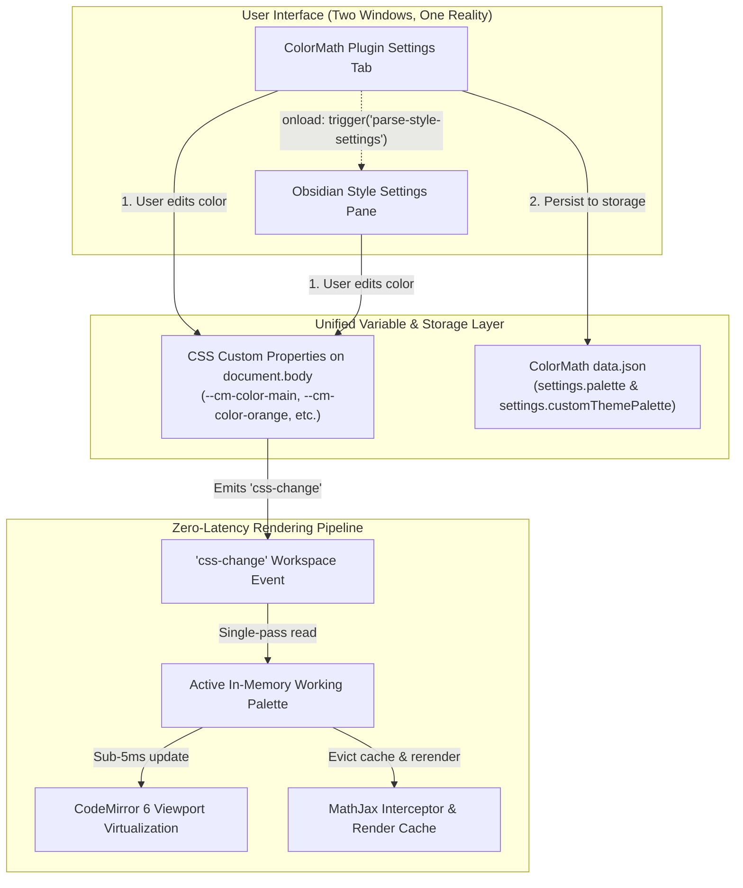

# 📋 Unified Implementation Plan: Style Settings (Approach 1) & Blank Custom Theme

## Goal Description
Implement full compatibility between **ColorMath** and the **Obsidian Style Settings** plugin using **Approach 1: Unified CSS Variables**, alongside introducing a dedicated **Blank "Custom" Theme** with strict Edit/Delete lifecycle rules.

This implementation satisfies three major objectives:
1. **Approach 1: Unified Shared CSS Variables**: ColorMath's internal settings tab and the Style Settings tab share the exact same CSS custom properties (`--cm-color-...`). Updating in either tab reflects instantly across both without priority conflicts or ghost overrides.
2. **Blank "Custom" Theme**: A dedicated theme option that provides users with a clean-slate canvas. Unlike preset themes (Tokyo Night, Catppuccin, Nord, Clean Light), the Custom Theme has **no reset option**; users can only **Edit** it or **Delete** it.
3. **Roadmap 1.11 Phase 2 Fulfillment**: Directly delivers the $\mathcal{O}(1)$ CSS custom property reactivity, matrix breathing room geometry, and print/PDF theme inheritance outlined in [TODO.md#L36-L43](file:///c:/Users/aditya/Documents/GitHub/color-math/TODO.md#L36-L43).

---

## Architectural Data Flow & Unified Coherence



---

## Key Feature Specifications

### 1. Approach 1: Unified CSS Variables
* **Shared Contract**: All 13 semantic roles and rainbow tiers map to `--cm-color-<role>` and `--cm-rainbow-<tier>`.
* **ColorMath Tab Action**: When a user changes a color picker or text input in ColorMath's settings tab:
  1. It writes `document.body.style.setProperty('--cm-color-<role>', value)`.
  2. It updates `this.settings.palette[role] = value`.
  3. It triggers `this.plugin.saveSettings()`.
* **Style Settings Tab Action**: When a user changes a color in Style Settings:
  1. Style Settings injects `--cm-color-<role>` onto `document.body`.
  2. Obsidian triggers the `css-change` workspace event.
  3. ColorMath's `handleThemeChange()` reads the updated CSS variables into memory and refreshes math decorations without writing redundant overrides to disk.
* **Coherence Guarantee**: Both tabs manipulate the identical CSS variables. There is no state drifting or conflicting priority.

---

### 2. Blank "Custom" Theme Architecture
* **Preset Dropdown**: Add `"custom"` to the Preset Themes dropdown (`"Custom Theme (Blank Slate)"`).
* **Storage**: Introduce `customThemePalette: ColorPalette | null` in `ColorMathSettings`.
* **Blank Canvas Initialization**:
  * Selecting "Custom Theme" for the first time initializes an unstyled or user-tailored palette (or clones the current active colors as the starting baseline if blank).
* **No Reset Option**:
  * Preset themes (Tokyo Night, Catppuccin, Nord, Clean Light) have default reset configurations.
  * The **Custom Theme explicitly Omits any "Reset to Default" button**. Its state belongs entirely to the user.
* **Lifecycle Controls**:
  * **Edit**: The user edits any of the 13 roles or rainbow tiers via ColorMath's pickers or Style Settings. Every edit updates `this.settings.customThemePalette`.
  * **Delete**: A dedicated button **"Delete Custom Theme"** with a confirmation dialog:
    * Clears `this.settings.customThemePalette = null`.
    * Switches the active theme back to `tokyo` (Tokyo Night Signature default).
    * Restores default CSS properties and notifies the user with a clean notice.

---

### 3. Style Settings Declarative Schema (`styles.css`)
Expose 4 structured categories inside `/* @settings ... */` in `styles.css`:

1. **Category 1: Mathematical Semantic Roles (13 Roles)**:
   - `cm-color-main`: Primary Variables & Base Functions (`#7aa2f7`)
   - `cm-color-orange`: Constants & Greek Constants (`#e0af68`)
   - `cm-color-derivative`: Derivatives & Differentials (`#bb9af7`)
   - `cm-color-chain`: Chain Rule, Vector Fields & Domain Boundaries (`#9ece6a`)
   - `cm-color-upper`: Exponents & Superscripts (`#9d7cd8`)
   - `cm-color-parameter`: Parameters & Bound Limits (`#ff9e64`)
   - `cm-color-energy`: Energy & Quantum Operators (`#2ac3de`)
   - `cm-color-set`: Set Theory & Logic Symbols (`#7dcfff`)
   - `cm-color-unit`: Physical Units (`#73daca`)
   - `cm-color-arrow`: Vectors & Transformation Arrows (`#f7768e`)
   - `cm-color-relation`: Relations & Equality (Tokyo/Light adaptive)
   - `cm-color-dot`: Dot Operators & Separators (Tokyo/Light adaptive)
   - `cm-color-spacing`: Math Spacing Delimiters (Tokyo/Light adaptive)
2. **Category 2: Rainbow Delimiters (Tiers 1–6)**:
   - `cm-rainbow-1` through `cm-rainbow-6` (`format: hex`).
3. **Category 3: Diagnostics & Warning Highlighting**:
   - `cm-color-unmatched-delim`: Unclosed Bracket Warning Color (`#f7768e`).
   - `cm-color-unmatched-bg`: Warning Background Tint (`rgba(247, 118, 142, 0.18)`).
4. **Category 4: Matrix Geometry & Spacing**:
   - `cm-matrix-cell-padding`: Horizontal cell padding slider (`0.45em`, `format: em`).
   - `cm-matrix-margin`: Outer matrix margin slider (`0.25em`, `format: em`).

---

## Proposed Changes

### Component: Style Definitions
Files:
- [obsidian-color-math/styles.css](file:///c:/Users/aditya/Documents/CODES/TypeScript/obsidian-color-math/styles.css)

#### [MODIFY] styles.css
- Add the `/* @settings ... */` YAML block containing the 4 categories.
- Update `.color-math-unmatched-delimiter` to consume `var(--cm-color-unmatched-delim, #f7768e)`.
- Update matrix cell rules to consume `var(--cm-matrix-cell-padding, 0.45em)` and `var(--cm-matrix-margin, 0.25em)`.

---

### Component: Core Configuration & Theme Engine
Files:
- [obsidian-color-math/src/config.ts](file:///c:/Users/aditya/Documents/CODES/TypeScript/obsidian-color-math/src/config.ts)
- [obsidian-color-math/src/utils/theme_colors.ts](file:///c:/Users/aditya/Documents/CODES/TypeScript/obsidian-color-math/src/utils/theme_colors.ts)

#### [MODIFY] src/config.ts
- Add `BLANK_PALETTE: ColorPalette` for creating empty/custom themes.

#### [MODIFY] src/utils/theme_colors.ts
- Implement `applyCssVariablesToDom(palette: ColorPalette, rainbow?: string[])`:
  - Sets corresponding `--cm-color-*` and `--cm-rainbow-*` on `document.body.style`.
- Implement `extractStyleSettingsOverrides(base: ColorPalette): { palette: ColorPalette; hasOverrides: boolean }`:
  - Safely reads active CSS custom properties from `getComputedStyle(document.body)` on `css-change` boundaries.

---

### Component: Plugin Main & Settings Tab
Files:
- [obsidian-color-math/src/main.ts](file:///c:/Users/aditya/Documents/CODES/TypeScript/obsidian-color-math/src/main.ts)

#### [MODIFY] src/main.ts
- In `ColorMathSettings` interface:
  - Add `activeThemePreset: string` (e.g. `"tokyo" | "catppuccin" | "nord" | "light" | "custom" | "none"`).
  - Add `customThemePalette: ColorPalette | null`.
  - Add `customThemeRainbow: string[] | null`.
- In `onload()`:
  - Call `this.app.workspace.trigger("parse-style-settings")` inside `onLayoutReadyHandler`.
  - Initialize DOM CSS variables from current active palette via `applyCssVariablesToDom()`.
- In `handleThemeChange()`:
  - On `css-change`, extract any Style Settings variables, update in-memory active palette, and call `rerenderMath()`.
- In `ColorMathSettingTab`:
  - Add `"custom"` to the Preset Themes dropdown.
  - When `"custom"` is selected:
    - Display a badge: `"Custom Theme (Active)"`.
    - **Do NOT render any Reset button** for this theme.
    - Render a **"Delete Custom Theme"** button (with confirmation) that wipes `customThemePalette` and reverts to `"tokyo"`.
  - Update color pickers: When picking a color in ColorMath's settings tab, immediately call `document.body.style.setProperty()` so Style Settings and the editor stay 100% unified.

---

### Component: Versioning & Documentation
Files:
- [obsidian-color-math/manifest.json](file:///c:/Users/aditya/Documents/CODES/TypeScript/obsidian-color-math/manifest.json)
- [obsidian-color-math/package.json](file:///c:/Users/aditya/Documents/CODES/TypeScript/obsidian-color-math/package.json)
- [obsidian-color-math/versions.json](file:///c:/Users/aditya/Documents/CODES/TypeScript/obsidian-color-math/versions.json)
- [GitHub/color-math/TODO.md](file:///c:/Users/aditya/Documents/GitHub/color-math/TODO.md)
- [GitHub/color-math/ROADMAP.md](file:///c:/Users/aditya/Documents/GitHub/color-math/ROADMAP.md)

#### [MODIFY] Version Bumps & Records
- Increment version from `1.0.65` $\to$ `1.0.66`.
- Update `TODO.md` marking the completion of Approach 1 Style Settings compatibility, Custom Theme engine, and CSS custom property reactivity.

---

## Verification Plan

### Automated Test Suite
Run the full test suite to guarantee 100% pass rate:
```powershell
npm test
```
Verify zero build errors:
```powershell
npm run build
```

### Manual Verification in Obsidian Vault
Using workspace synchronization protocol (`sync.mjs` Profile 2):
1. **Dry-Run & Review**:
   ```powershell
   node C:\Users\aditya\Documents\CODES\Sync\sync.mjs -Profile 2 -DryRun -AsJson
   ```
2. **Deploy to Vault**:
   ```powershell
   node C:\Users\aditya\Documents\CODES\Sync\sync.mjs -Profile 2 -Execute -Force
   ```
3. **Vault Verification Steps**:
   - **Custom Theme**:
     - Go to Settings $\to$ Color Math $\to$ Theme & Color Palettes.
     - Select **"Custom Theme"**.
     - Verify no "Reset" button exists for Custom Theme.
     - Edit a role color (e.g., Main variables to `#e60067`).
     - Verify math in Live Preview and Reading View immediately colors pink.
     - Switch to another theme (Nord) and then back to Custom; verify custom pink persists.
     - Click "Delete Custom Theme"; verify confirmation dialog and safe revert to Tokyo Night.
   - **Style Settings Coherence**:
     - Open Settings $\to$ Style Settings $\to$ Color Math.
     - Edit Main Variables to `#00ffcc`.
     - Check note: verify equation updates instantly.
     - Check Color Math settings tab: verify Main Variables reflects `#00ffcc`.
     - Adjust matrix cell padding slider: verify table equations expand smoothly.
